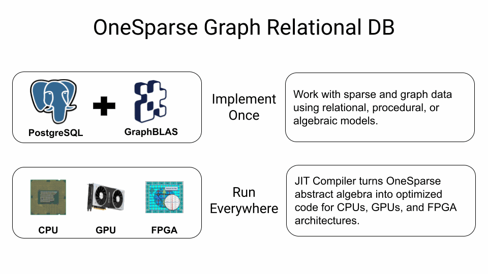

[](https://github.com/OneSparse/OneSparse/actions/workflows/test.yml)[](https://github.com/OneSparse/OneSparse/actions/workflows/pages/pages-build-deployment)



# See the [Documentation](https://onesparse.github.io/OneSparse/) 

## Container dependency versions

`versions.env` is the single source of truth for the PostgreSQL, SuiteSparse:GraphBLAS,
and LAGraph versions used by container builds. Update it, then run either:

```bash
./test.sh
./build-image.sh Dockerfile-slim onesparse/onesparse-slim:local
```

`build-image.sh` passes the configured versions to any project Dockerfile.
